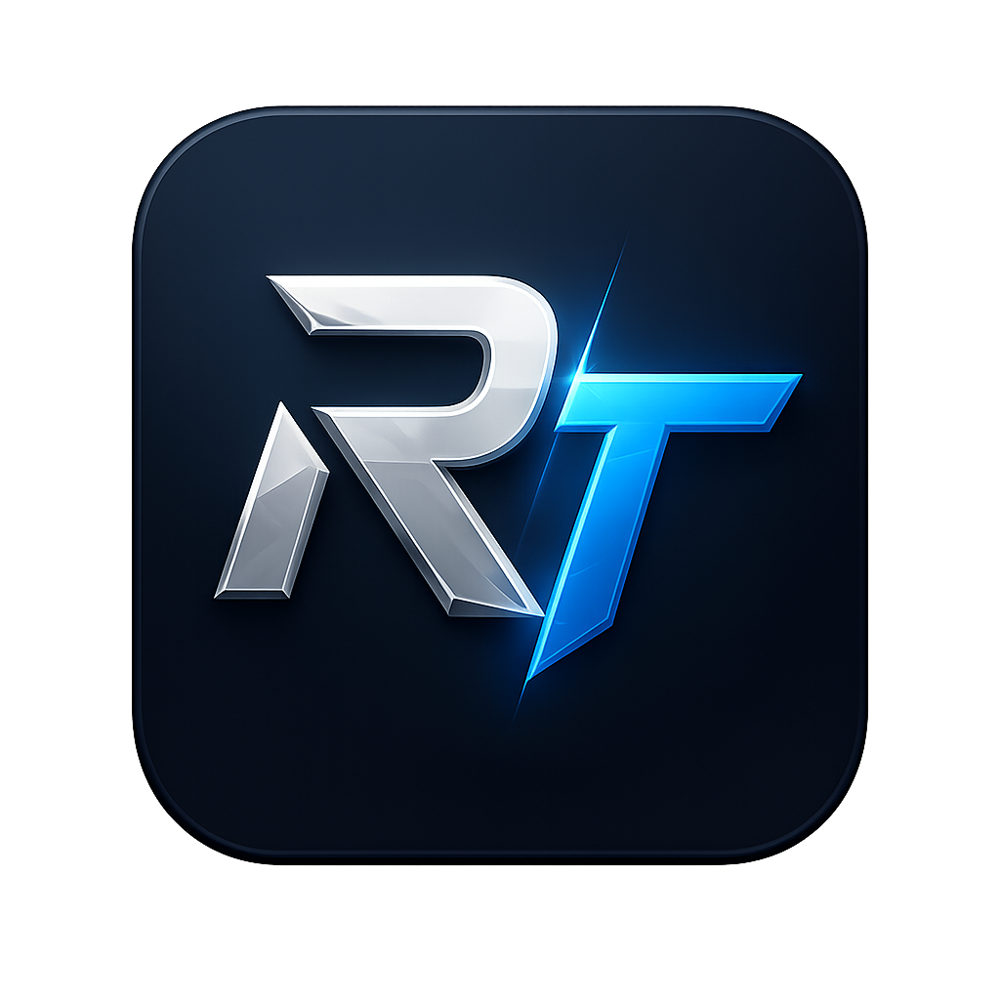
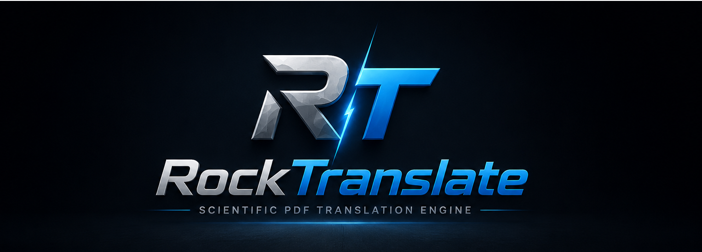
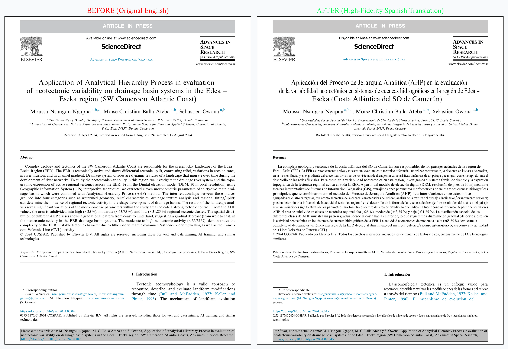
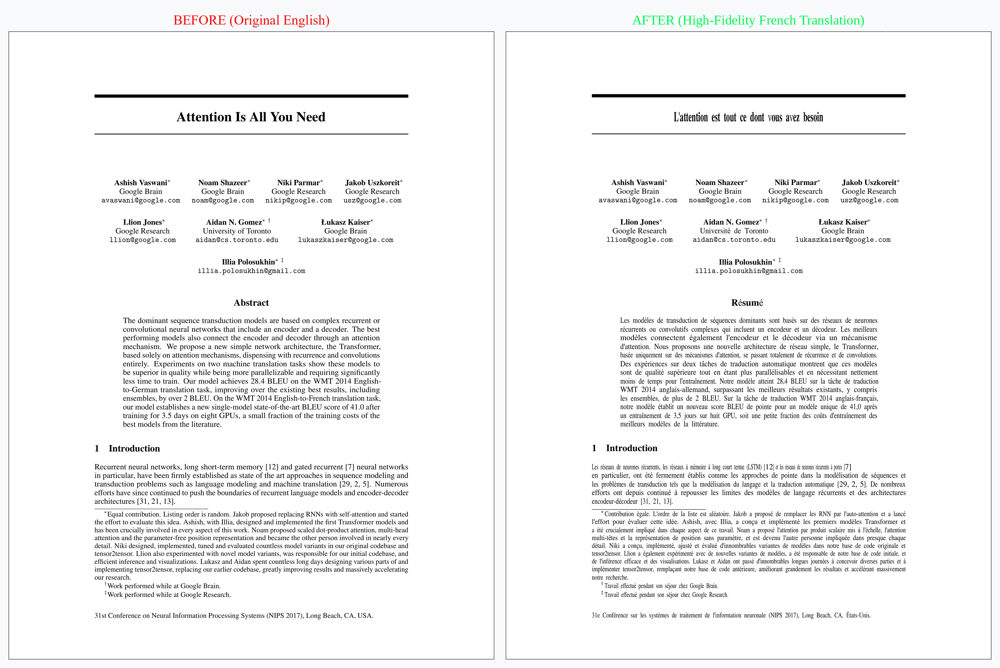
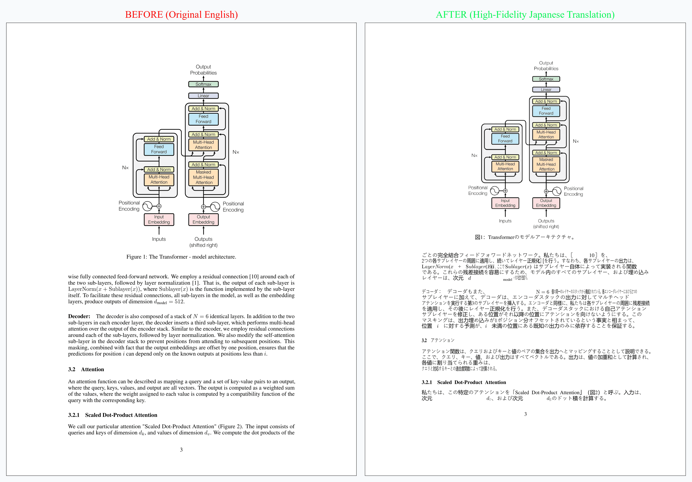
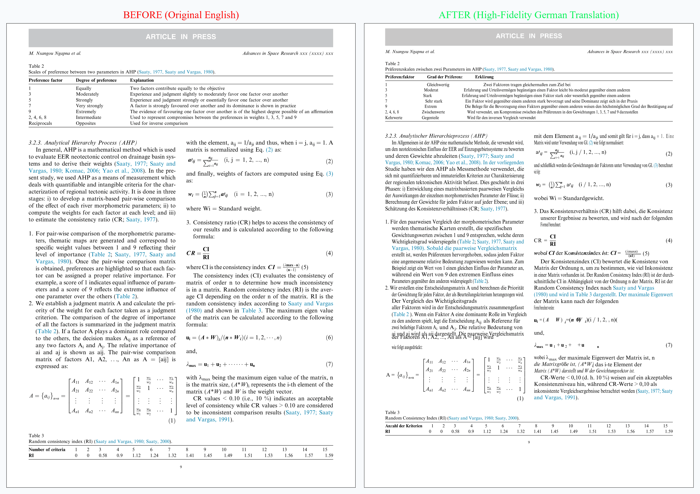

#  RockTranslate

<p align="center">
  
</p>

<p align="center">
  <strong>High-Fidelity AI Layout-Preserved PDF Translator</strong>
</p>

<p align="center">
  <!-- High-visibility dynamic download badge -->
  <a href="https://github.com/PerfectWin7777/RockTranslate/releases/download/v2.0.5/RockTranslate_Setup_v2.0.5.exe">
    
  </a>
</p>

<p align="center">
  
  
  
</p>

---

### 📥 [Click here to download the standalone Windows Desktop GUI Installer v2.0.5 (.exe)](https://github.com/PerfectWin7777/RockTranslate/releases/download/v2.0.5/RockTranslate_Setup_v2.0.5.exe)

---

## 1. Introduction & Origin Story

> *"RockTranslate breaks the limits of traditional PDF translation. By combining advanced LLMs with high-fidelity geometric DOM mapping, it reconstructs complex scientific papers from publishers like Elsevier and Springer into completely native, translated PDFs."*

### Our Story: Bridging the Academic Inequality Gap

Scientific and academic research is a global endeavor, yet the vast majority of high-impact literature is published in English. For students and researchers in developing nations, particularly in Africa and Cameroon, accessing, translating, and fully understanding these highly complex documents poses a massive challenge [1]. 

Traditional translation tools are either:
1.  **Prohibitively expensive** or heavily restricted by paid subscription tiers (e.g., DeepL, Google Translate).
2.  **Lacking visual layout preservation** (e.g., standard text extractors, legacy translation proxies), disrupting complex formulas, double-column structures, and tabular alignments [2].

**RockTranslate** was born out of academic necessity, created by students facing these exact barriers. It is designed to be a fully accessible, local-first, high-fidelity alternative that allows any researcher, anywhere, to translate academic PDFs without losing their original layout—empowering global education without financial borders [1].

---

## 2. Key Features

RockTranslate is a desktop application designed for translating scientific, technical, and academic PDF documents while preserving their original structure, formatting, figures, tables, and visual layout.

Built with a local-first architecture, RockTranslate prioritizes performance, reliability, and user control. The application combines advanced document analysis, intelligent translation workflows, and high-fidelity PDF reconstruction to deliver professional-quality results.

*   **Layout-Preserved PDF Translation:** Retains the exact geometry, columns, margins, and alignment of the original document [2].
*   **Paragraph-Level Translation with Justified Reflow (new in 2.0.5):** Lines are regrouped into real paragraphs, translated as whole sentences, then reflowed into the original line boxes with one uniform scale per paragraph — justified when the source was justified, like professional document translators.
*   **Protected PDFs:** Copy-restricted publisher PDFs open normally; password-protected PDFs prompt for their password (kept in memory only).
*   **Scientific and Technical Document Support:** Specially designed to handle mathematical formulas, indices, equations, and proper academic nomenclature.
*   **High-Fidelity PDF Reconstruction:** Preserves figures, images, and tables in their original spatial coordinates.
*   **Fast & Economical:** Concurrent LLM requests (4 by default), hidden-reasoning disabled where supported (≈5× faster, ≈4× cheaper on DeepSeek), and a translation cache: nothing is ever paid twice for the same text.
*   **Transparent Usage:** Live elapsed time, remaining time, tokens and estimated cost during each run, plus cumulative statistics per model.
*   **Original Text on Hover:** Hover a translated paragraph to read the original in a bubble (toggle in Settings; Ctrl + hover always works).
*   **Native pdf2htmlEX 0.18.8 on Windows (new in 2.0.5):** The first public native 64-bit Windows build of pdf2htmlEX 0.18.8 — built by our CI from source ([build recipe](tools/pdf2htmlex-windows), [engine release](https://github.com/PerfectWin7777/RockTranslate/releases/tag/engine-pdf2htmlex-0.18.8.rc1-win64)) — 1.4–2.5× faster than the old 32-bit 0.14.6 and free of its 2 GB memory limit.
*   **Synchronized Side-by-Side View:** Original PDF on the left; on the right, the reconstructed layout, prepared in the background as soon as the PDF opens (no AI, no cost), so translation starts instantly. Same zoom and synchronized scrolling; a collapsible progress panel shows pages, segments, time, tokens and cost.
*   **Exact Layout Measurement with Your Browser:** Paragraph geometry is measured with the installed Edge or Chrome (driven through the DevTools protocol), or with a small headless engine fetched in the background — nothing to install by hand.
*   **Light & Dark Themes:** A native-feeling interface (light, dark or follow the system) with a unified Settings window (Ctrl/⌘+,).
*   **Lightweight and Responsive User Experience:** Optimized loading speeds and visual feedback indicators.
*   **Privacy-Conscious Workflow:** Supports offline and local-first execution via local LLMs (Ollama) to guarantee complete data privacy.
*   **Open-Source and Community-Driven:** Built entirely on open-source foundations, giving control back to the scientific community.

---


## 3. Installation

Choose the installation method that best suits your requirements:

### A. Package Installation (via pip)
RockTranslate is officially published on PyPI. You can install the core lightweight library (CLI & API only) or include full desktop GUI support:

**For CLI & Programmatic API only (Lightweight, No GUI):**
```bash
pip install rocktranslate
```
**For the full Desktop Graphical User Interface (GUI):**
```bash
pip install "rocktranslate[gui]"
```

### B. Development Installation (via Git)
For the most up-to-date features, or to run the application directly from source:
```bash
# Clone the repository
git clone https://github.com/PerfectWin7777/RockTranslate.git
cd RockTranslate

# Install dependencies and the package in editable mode
pip install -e .
```

### C. Direct Remote Install
You can also install the development version directly from GitHub without cloning the repository manually:
```bash
pip install git+https://github.com/PerfectWin7777/RockTranslate.git
```

---

## 4. Visual Demonstration (Before & After)

### Real-Time Application Lifecycle
*The following animation demonstrates opening, rendering, and translating a multi-column paper dynamically:*

<p align="center">
  
</p>

---

### 🔬 1. English to Spanish (Elsevier Double-Column Layout)
*Demonstrating perfect preservation of multi-column text flow, publisher headers, and author blocks.*



*The original Elsevier double-column layout is fully retained with zero text-overlapping or margin drift.*

---

### 🧠 2. English to French (Attention Is All You Need — Abstract & Title)
*Demonstrating precise preservation of scientific structures, titles, and mathematical equations.*



*Mathematical formulas, paragraph flows, and proper academic register remain completely intact.*

---

### 🌸 3. English to Japanese (Attention Is All You Need — Paragraph Flow)
*Demonstrating robust handling of double-byte CJK characters without vertical line collapses or overlapping.*



*Japanese Kanji and Kana characters are rendered cleanly with proportional horizontal scaling.*

---

### 🌸 4. English to German (Elsevier Double-Column Layout— Paragraph Flow and Table)
*Demonstrating robust preservation of tables and math formulas in a double-column layout..*



*Clarity of paragraphs, tables and styles, preservation of mathematical formulas.*

---

## 5. The Three Versions

RockTranslate provides three entry points to support any workflow:

### A. Graphical User Interface (GUI)
A responsive desktop application featuring:
*   Synchronized dual-pane viewports (Original PDF vs. Live Translated HTML) [2].
*   Real-time zoom sliders and page navigation.
*   Visual shimmer skeleton loaders and real-time status bars [1, 2].

### 📥 [Click here to download the standalone Windows Desktop GUI Installer v2.0.5 (.exe)](https://github.com/PerfectWin7777/RockTranslate/releases/download/v2.0.5/RockTranslate_Setup_v2.0.5.exe)

### B. Command-Line Interface (CLI)
A lightweight execution engine that can be run globally from the terminal once installed [3].

#### Usage Examples:
1.  **Translate to French with the model saved in the GUI (or the default):**
    ```bash
    rocktranslate paper.pdf -l French
    ```
2.  **Translate only some pages (only those pages are converted):**
    ```bash
    rocktranslate paper.pdf -l Spanish --pages "1-3, 7" -o paper_es.pdf
    ```
3.  **Use DeepSeek, OpenAI, Gemini… (LiteLLM model routes):**
    ```bash
    export DEEPSEEK_API_KEY=sk-...
    rocktranslate paper.pdf -m deepseek/deepseek-flash -l German --parallel 6
    ```
4.  **Fully local translation with Ollama (no API key):**
    ```bash
    rocktranslate paper.pdf -m ollama/llama4 --base-url http://localhost:11434
    ```
5.  **Password-protected PDF:**
    ```bash
    rocktranslate locked.pdf --password "secret"
    ```
6.  **Check the environment (pdf2htmlEX, PDF engine, API keys):**
    ```bash
    rocktranslate doctor
    ```

Each run ends with a summary (segments, time, tokens, estimated cost). Exit code `0` = success, `2` = partial result (some batches failed, the PDF was still produced), `1` = failure.

**No browser to install manually:** RockTranslate prints PDFs with an installed Chrome / Edge / Chromium / Brave, and otherwise downloads a pinned `chrome-headless-shell` into your user folder (never into `site-packages`). On Windows, the pdf2htmlEX engine (native x64 build of 0.18.8) is downloaded on first use when it is not bundled. On Linux, the official pdf2htmlEX AppImage is extracted automatically — no FUSE required (Docker, WSL, Ubuntu 22.04+). Override with `ROCKTRANSLATE_BROWSER=/path/to/chrome` if needed.

---

### 💡 Dynamic Model Routing & Frontier Models Guidance

#### 1. Model Naming Convention (LiteLLM Integration)
RockTranslate inherits its entire model routing architecture directly from **LiteLLM**. All model identifiers passed through the `-m / --model` CLI flag (or through the API) must strictly follow the standard `provider/model_name` syntax. 

Both the provider prefix and the model name must match the exact naming conventions defined in the [LiteLLM Supported Providers & Models Documentation](https://docs.litellm.ai/docs/providers).

#### 2. Why Frontier Models are Essential for Perfect Visual Layouts
While local or lightweight models function perfectly, we highly recommend using advanced **frontier models**—such as **Gemini 3.8 Flash**, **GPT-5.6 Terra**, **Claude 5 Sonnet**, **DeepSeek V4**, **Llama 4**, or **Kimi K2.6**—for complex scientific papers. 

*   **Instruction-Following & Tag Integrity:** Frontier models possess superior reasoning capabilities. They strictly preserve nested XML style tags (like `<color_HEX>`) and structural JSON mapping arrays, allowing the renderer to position text segments with pixel-perfect accuracy.
*   **Academic Register & Context:** They avoid literal, broken word-by-word translations of fragmented segments. Instead, they understand the global paragraph context, translating complex double-column academic layouts into natural scientific prose.


### C. API Developer Library
Integrate layout-preserved document translation directly into your Python scripts or data pipelines.

#### Programmatic Integration:
```python
from rocktranslate import RockTranslator

rt = RockTranslator(
    model="deepseek/deepseek-flash",   # any LiteLLM route: gemini/..., openai/..., ollama/...
    target_lang="French",              # API key read from DEEPSEEK_API_KEY (or pass api_key=...)
    parallel=4,                        # concurrent requests
    temperature=0.3,                   # faithful translation
)

report = rt.translate_document("paper.pdf", "paper_fr.pdf", pages="1-5")
print(report.success, report.output_path)
print(f"{report.segments_translated} segments in {report.seconds:.0f}s, "
      f"{report.prompt_tokens + report.completion_tokens} tokens, ~${report.cost_usd:.3f}")

# Backward-compatible boolean API
ok = rt.translate("paper.pdf")
```

The library never reads hidden GUI settings for what you pass explicitly (model, key, temperature, retries), and caches translations by document content: re-running the same document is free.

### D. Structured Extraction & Aligned Translation (new in 2.0.5)

RockTranslate also turns a PDF into **typed, positioned elements** — the schema popularized by [Unstructured](https://docs.unstructured.io) — and, unlike layout-only extractors, every element can carry its **aligned translation**.

```python
import rocktranslate

# 1. Structure only: local, free, no API key
doc = rocktranslate.extract("paper.pdf")
print(doc)            # <Document 'paper.pdf': 531 elements (135 NarrativeText, 31 Section, 4 Table, ...)>
doc.to_markdown("paper.md")                     # headings, paragraphs, lists, tables, captions
doc.to_json("paper.json")                       # elements with page + box in PDF points
doc.to_json("paper.unstructured.json", unstructured=True)   # Unstructured's category names
chunks = doc.chunks(max_characters=1500)        # section-aware chunks for RAG, with their boxes

for table in doc.tables:                        # real rows x cells, also as HTML
    print(table.table[:3], table.html[:80])

# 2. Find a passage and show it in the ORIGINAL PDF
hits = doc.search("multi-head attention")
doc.highlight(hits, "paper.pdf", "paper_highlighted.pdf")

# 3. Translate: the same elements, each with its translation
doc = rocktranslate.translate("paper.pdf", lang="German", pages="1-2")   # also writes the translated PDF
doc.to_markdown("paper.de.md", bilingual=True)  # original paragraph, then its translation
doc.search("Aufmerksamkeit")                    # search in German, get the English source too
print(doc.report.cost_usd, doc.output_pdf)
```

```bash
rocktranslate extract paper.pdf -f json,md,chunks          # structure only
rocktranslate paper.pdf -l German -f pdf,json,md --bilingual
```

| Element type | What it is |
|---|---|
| `Title` / `Section` | document title; numbered or typographic headings, with `category_depth` (3.2.1 → 2) |
| `NarrativeText`, `ListItem`, `Reference` | paragraphs (regrouped across lines), list items, bibliography entries |
| `Table` | rows × cells (`table`), `text_as_html`, translated cell by cell |
| `FigureCaption`, `TableCaption`, `Formula`, `Footnote` | captions, displayed equations, notes |
| `Header`, `Footer`, `FigureText` | page furniture and labels inside figures (kept in JSON, left out of Markdown/chunks) |

**Measured on the same PDFs** (Unstructured 0.18 `strategy="fast"`, the pdfminer-based mode that needs no ML model):

| | Unstructured fast | RockTranslate `extract` |
|---|---|---|
| *Attention Is All You Need* (15 p.) | 158 `Title` (every author block), garbled arXiv stamp, 0 tables | 1 title + 31 sections with depth, 4 tables, captions, formulas, stamp read correctly |
| Geological paper, 35 p., many tables | 3,482 elements, **2,898 `UncategorizedText`** (tables shattered into numbers) | 780 elements, **9 tables** rebuilt row by row |

Limits: scanned PDFs (no text layer) need OCR, which RockTranslate does not do; only PDF input.

---

## 6. Known Limitations & Roadmap (TODO)

### Current Limitations:
*   **Fonts embedded as subsets:** publisher PDFs only embed the glyphs they use. Translated text needing other glyphs (accents, CJK) falls back to a system font for those characters, which can look slightly different.
*   **Run-in headings and complex inline math:** a line starting with a bold run-in heading ("**Residual Dropout** We apply…") or packed with inline formulas is translated line by line instead of as part of its paragraph.
*   **Longer target languages** shrink the text of a paragraph uniformly to keep it inside its original box (as other layout-preserving translators do).
*   **Scanned PDFs** (images only) are not supported yet (no OCR).
*   **pdf2htmlEX on Windows** is our own native x64 build of pdf2htmlEX 0.18.8 (recipe in `tools/pdf2htmlex-windows/`), bundled by the installer and downloaded on first use otherwise (~16 MB). If a conversion stops making progress, RockTranslate stops the process and reports the reason.

### Roadmap:
*   [ ] **Structured extraction (`to_json`, `to_markdown`)**: expose the document model (titles, paragraphs, tables, captions, reading order) for RAG and analysis pipelines.
*   [ ] **Bilingual export (TMX / JSON)** of every translated segment.
*   [ ] **Scanned PDF support** through a local OCR fallback.
*   [ ] **Sliced parallel conversion** of very large documents (merger already prototyped in `core/html_merger.py`).

---

## 7. Contributing & Community Support

We believe in making scientific literature universally accessible and welcome contributions from researchers, developers, and educators. Here is how you can help advance the project:

*   **UI/UX Polish:** Help us improve the `pywebview` interface — modal dialogs, theming, accessibility, and layout refinements.
*   **Bug Reports & Edge Cases:** Found a PDF with highly complex LaTeX layout issues? Open an issue and upload the file (or a sample page) so we can optimize our BeautifulSoup parser rules.
*   **Translation & Localization:** Contribute internationalization dictionaries (in `src/rocktranslate/assets/ui/js/i18n.js`) to make the user interface available in more languages.
*   **Prompt Optimization:** Help us refine the instructions in `prompts.py` to further improve terminology preservation and tag alignment across different languages.

To contribute, please fork the repository, make your changes in a dedicated branch, and submit a pull request. For major architectural modifications, feel free to open an issue first to discuss your ideas with the core maintainers.

---

## 8. Acknowledgements & Credits

RockTranslate stands on the shoulders of giants. We would like to express our deepest gratitude to the open-source projects that made this tool possible:
*   **pdf2htmlEX:** The geometric engine used to compile PDF structures into HTML [2.2.1] ([GitHub](https://github.com/pdf2htmlEX/pdf2htmlEX)).
*   **Poppler & FontForge:** The underlying vector engines driving pdf2htmlEX [3.2.4] ([Poppler Website](https://poppler.freedesktop.org/) | [FontForge Website](https://fontforge.org/)).
*   **LiteLLM:** The multi-provider AI routing wrapper [2.3.1] ([Official Documentation](https://docs.litellm.ai/)).
*   **BeautifulSoup4 & lxml:** Driving high-speed, programmatic DOM analysis ([BeautifulSoup Documentation](https://www.crummy.com/software/BeautifulSoup/bs4/doc/) | [lxml Website](https://lxml.de/)).